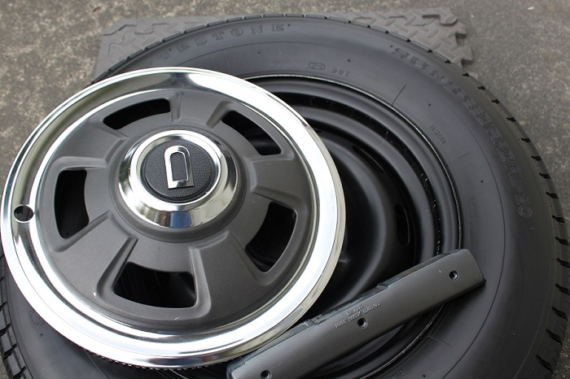
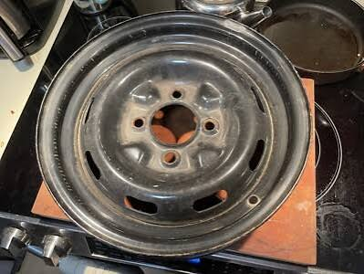
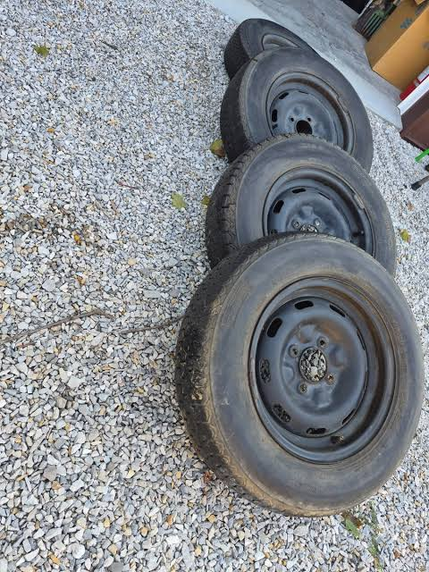
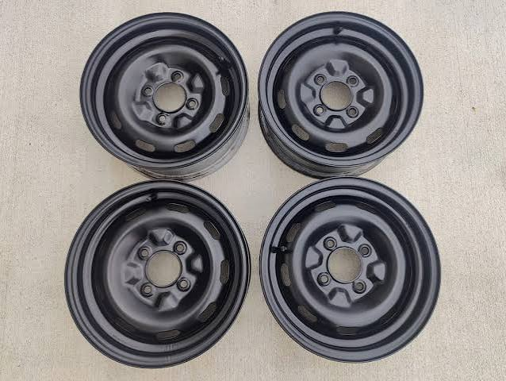
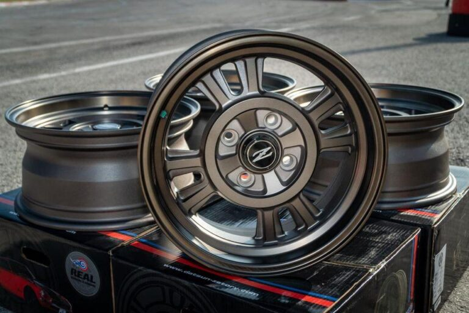
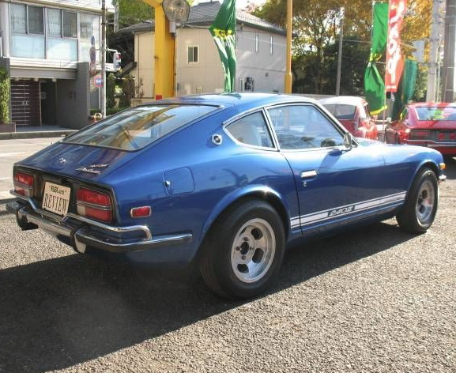
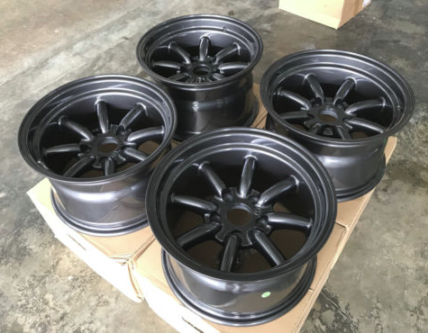

#240z steel wheel [reference](https://zcarguide.com/datsun-240z-tires-wheels-guide-best-wheels-tires-240z/)

## Key points
### Original Steel Wheel
The Datsun 240Z features a 175/70R14 size tire. For those unfamiliar with tire sizing standards, this refers to the following:

- A width of 175mm, meaning the width of the tire from sidewall.
- An aspect ratio of 70%, meaning that the tire’s height is equal to 70% of the width.
- A radial construction, meaning that the layers of the tire run radially across the tire.
- A diameter of 14″, meaning the size of the wheel from one end to the other. A 14″ tire is meant to fit a 14″ wheel.
- The wheel sizing for a 240Z is a 5.5Jx14 ET15, meaning a 5.5″ width and a 14″ diameter, with a 15mm offset.
### Steel Wheel
- 5.5Jx14 ET15 
- rim only 
- rim with tyre 
- steelie 

### Alloy Wheels
- 15x7J KS Competition Works Rally Mags 
- 14×7 Aluminum Slotted Mags 
- Panasport RS Watanabe 
